<p align="center">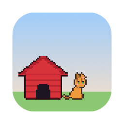</p>

<h1 align="center">PR Pets</h1>

<p align="center">Little pixel pets that wander out of a doghouse on your desktop whenever someone's waiting on your code review.</p>

<p align="center">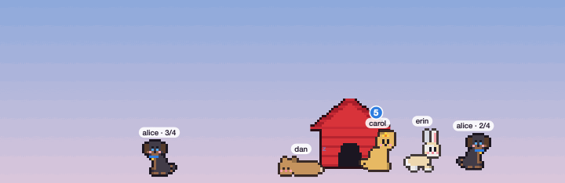</p>

Each pull request that needs your review gets a pet: a procedurally generated cat, dog, bunny or fox with the author's name above it. When the PR is merged, approved by someone else, or no longer needs you, the pet runs back into the doghouse. PR Pets reads your PRs through your existing [GitHub CLI](https://cli.github.com) login, so there are no tokens to set up.

## Install

```sh
curl -fsSL https://raw.githubusercontent.com/thehenrymcintosh/pr-pets/main/install.sh | bash
```

This puts **PR Pets.app** in `~/Applications` and opens it. You'll need macOS 14 or later, plus the GitHub CLI, logged in:

```sh
brew install gh
gh auth login
```

**Updating:** PR Pets checks for new releases once a day. When there's one, **Update to vX.Y.Z** appears in its menus and in Settings; it downloads, verifies the checksum, swaps itself in and restarts. Re-running the install command does the same thing.

Want to look before you have a review waiting? Open **Settings → GitHub → Pull requests from → Demo data**.

## What it does

<table>
<tr>
<td width="50%">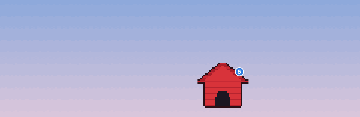</td>
<td width="50%">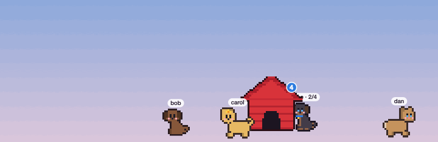</td>
</tr>
<tr>
<td><b>New review requests.</b> Each one queues at the door, and the pets come out one at a time.</td>
<td><b>Handled elsewhere.</b> Someone else approved Bob's PR, so his pet heads home. Then Dan's gets muted.</td>
</tr>
<tr>
<td>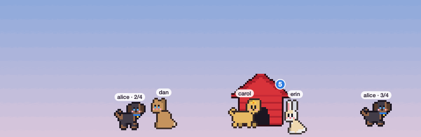</td>
<td>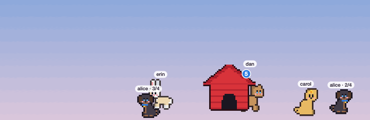</td>
</tr>
<tr>
<td><b>Double-click the doghouse</b> to send everyone inside; double-click again to let them out. A pair of eyes peeks out while they wait.</td>
<td><b>Hover a pet.</b> It stops, sits, looks at you, and shows the PR's title, number and lines changed.</td>
</tr>
</table>

Pets pick spots away from one another, walk in front of and behind the doghouse, sit, nap, and occasionally get the zoomies. **Drag the doghouse** to move the whole yard: pets walk along the ground line at its base, either near the doghouse or across the whole screen.

<p align="center">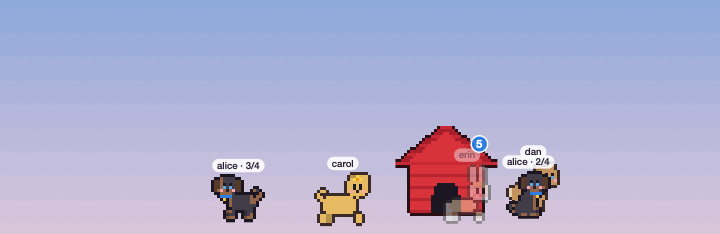</p>

### Stacked PRs

When PRs are based on each other's branches, PR Pets treats them as a stack. Every pet in a stack shares a look, wears a blue collar with a gold tag, and its name tag shows where it sits in the stack, such as `alice · 2/4`.

### Click a pet

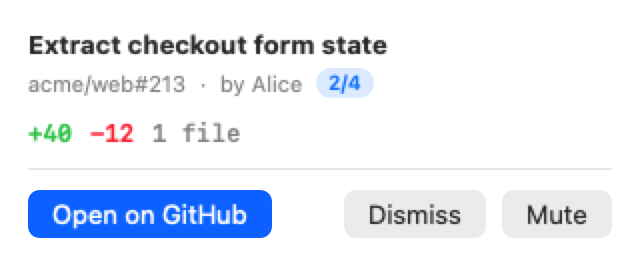

You'll see the title, author, stack position and lines changed, with three buttons:

- **Open on GitHub**
- **Dismiss** sends the pet home until the author pushes new commits.
- **Mute** sends it home for good.

Either can be undone from the dashboard.

<br clear="right">

### Click the doghouse

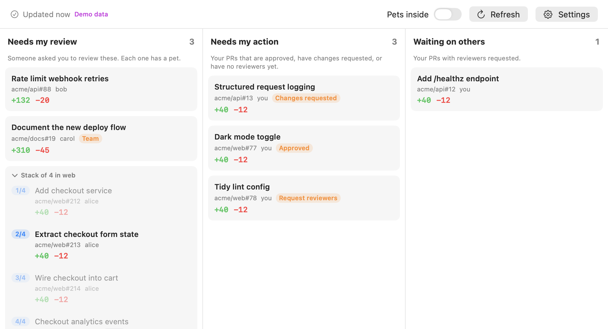

The dashboard has three columns:

- **Needs my review**: PRs that request your review, directly or via a team.
- **Needs my action**: your PRs that are approved, have changes requested, are drafts, or have no reviewers yet. Each is tagged with the reason.
- **Waiting on others**: your PRs with reviewers requested.

A PR that belongs to a stack is shown with the whole stack, in order, and the members that aren't for you are greyed out. Click the stack header to collapse it to just the PRs that need you.

The doghouse badge counts the pets waiting for you. It turns into a **!** if PR Pets can't reach GitHub, and the dashboard says why. Right-click the doghouse, or use the paw in the menu bar, for a menu.

## The pets

<p align="center">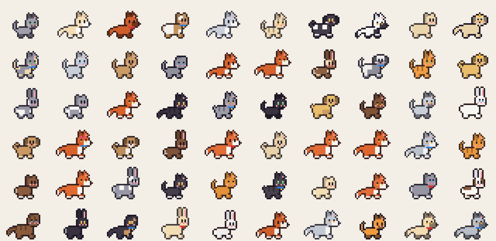</p>

Every pet is generated from a seed that's saved for its PR, so it keeps its look across restarts. Pets in the same stack share a seed. What varies:

- species, coat, secondary coat and eye colour
- pattern: tabby, patches, socks, tuxedo, spots or points
- ears, tail and build
- an occasional bow, bandana or flower
- temperament, which sets how energetic, sleepy and curious it is

<p align="center">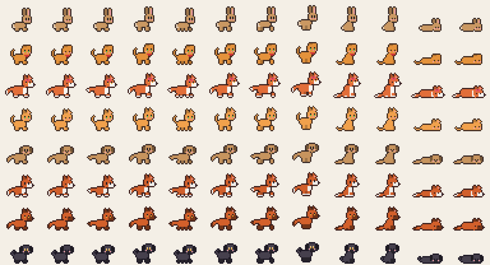</p>

Each pet has twelve frames: stand, blink, four walking, two running, sit, sit-and-blink, and two sleeping. The walk cycle follows the distance a pet has actually travelled, so its feet never slide.

| Cats | Dogs |
| --- | --- |
| 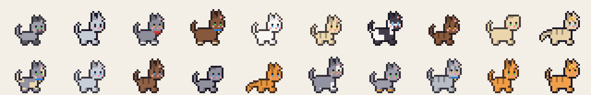 | 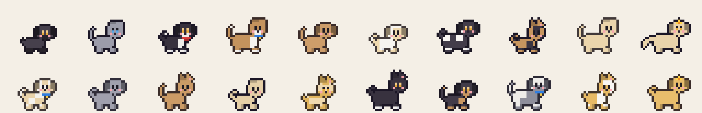 |
| **Bunnies** | **Foxes** |
| 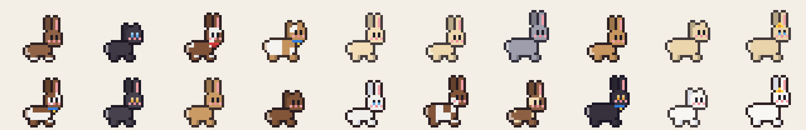 | 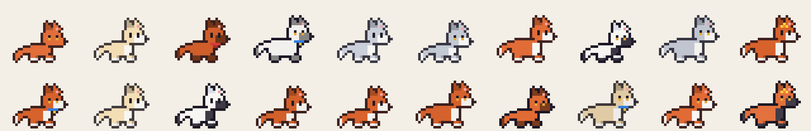 |

## Settings

Open Settings from the doghouse's right-click menu, the menu bar paw, or the dashboard.

| Tab | What's there |
| --- | --- |
| **GitHub** | How often to check (default every 3 minutes), `gh` path, GitHub Enterprise host, whether team review requests count, only-these-orgs, ignored repositories, whether to fetch whole stacks |
| **Pets** | Send inside, go home once someone else approves, hover cards, maximum pets, name tag (username, name, repo or none), which species can appear |
| **Placement** | Scale, roam near the doghouse (and how far) or across the whole screen, reset position, menu bar icon, launch at login, automatic update checks |

Settings are saved in `~/Library/Application Support/PR Pets/settings.json`.

## Troubleshooting

- **The doghouse shows "!"**: open the dashboard; the problem is described at the top. Usually `gh` isn't installed or isn't logged in (`gh auth login`).
- **"Couldn't find the GitHub CLI"**: apps opened from Finder don't see your shell's `PATH`. PR Pets checks the usual Homebrew, Nix and `~/.local/bin` locations. Anywhere else, set **Settings → GitHub → gh path** to the output of `which gh`.
- **macOS says the app can't be opened**: PR Pets is ad-hoc signed, not notarised. The install script clears the quarantine flag for you. If you downloaded the zip by hand, run `xattr -dr com.apple.quarantine ~/Applications/"PR Pets.app"`.
- **Logs**: `log stream --predicate 'subsystem == "dev.prpets"'`
- **Uninstall**: quit from the menu, then delete `~/Applications/PR Pets.app` and `~/Library/Application Support/PR Pets`.

## Development

You need macOS 14+ and either Xcode or just the Command Line Tools (`xcode-select --install`).

```sh
make test         # 71 tests: queue logic, stacks, triage, the pet simulation, sprites, rendering, gh parsing, updates
make demo         # run the app against scripted demo PRs
make preview      # render sprite sheets and scenario GIFs to ./previews
make screenshots  # run the real app on demo data and save its windows to ./previews/app
make install      # build from source into ~/Applications
```

The pet simulation and pixel art are plain Swift with no AppKit, so they're tested and rendered headlessly. `pr-pets-preview` draws with the same renderer as the app, so the GIFs in this README are exactly what ships (`make docs-images` regenerates them).

To cut a release, push a version tag (`git tag v0.2.0 && git push --tags`). The release workflow tests, builds a universal (Apple silicon + Intel) app, and publishes `PR-Pets.zip` with its SHA-256 checksum.

[docs/ARCHITECTURE.md](docs/ARCHITECTURE.md) explains how the pieces fit together. [CONTRIBUTING.md](CONTRIBUTING.md) covers adding species, behaviours or settings.

PR Pets supports macOS and GitHub today. Its core is platform-neutral: another forge needs a new `PullRequestSource`, and another OS needs a new shell.

## License

[MIT](LICENSE) © Henry McIntosh
